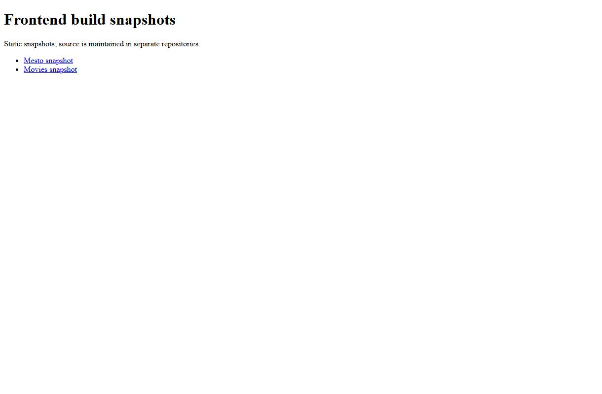

# 📦 Frontend · опубликованные сборки

**Два зафиксированных интерфейса из портфолио, доступные для просмотра как статические файлы.**

[Открыть витрину](https://goldlexx.github.io/frontend/) · [Снимок Mesto](https://goldlexx.github.io/frontend/build-mesto/) · [Снимок Movies Explorer](https://goldlexx.github.io/frontend/build-movies/)

## Что находится внутри

| Каталог | Содержимое | Актуальная разработка |
| --- | --- | --- |
| [build-mesto/](build-mesto/) | Готовые HTML, CSS и JavaScript интерфейса Mesto | [Mesto React](https://github.com/goldlexx/mesto-react) · [Mesto Full-stack](https://github.com/goldlexx/react-mesto-api-full) |
| [build-movies/](build-movies/) | Готовая сборка Movies Explorer | [Исходный клиент](https://github.com/goldlexx/movies-explorer-frontend) |

Эти версии фиксируют состояние приложений на момент сборки. Более поздние исправления и текущие настройки API ищите в исходных репозиториях. Работоспособность функций с учётной записью зависит от API, указанного внутри конкретной сборки.

## Просмотр

Используйте ссылки на снимки вверху. [Workflow Pages](.github/workflows/deploy.yml) создаёт страницу выбора и переносит обе папки в артефакт публикации. В репозитории нет исходных компонентов или `package.json` для повторной сборки.
